# BigBasket AI — Project Gallery

Screenshots and analysis figures are extracted from the submitted 17-page university project report. Screenshots show the reported Streamlit application and are not newly generated renders.

## Application screenshots

### Command Center

Overview KPIs, market snapshot and category distribution.

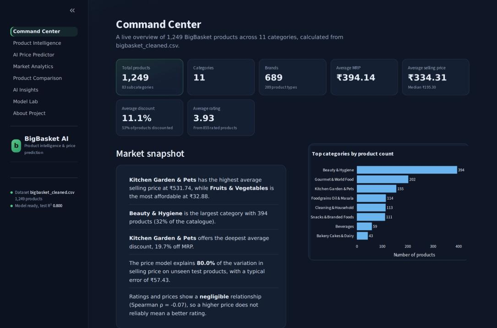

### Product Intelligence

Product filters, search, sorting and product-level exploration.

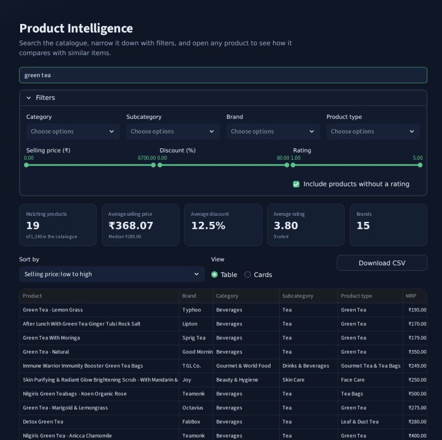

### AI Price Predictor

Selling-price estimate and prediction interval for a selected product.

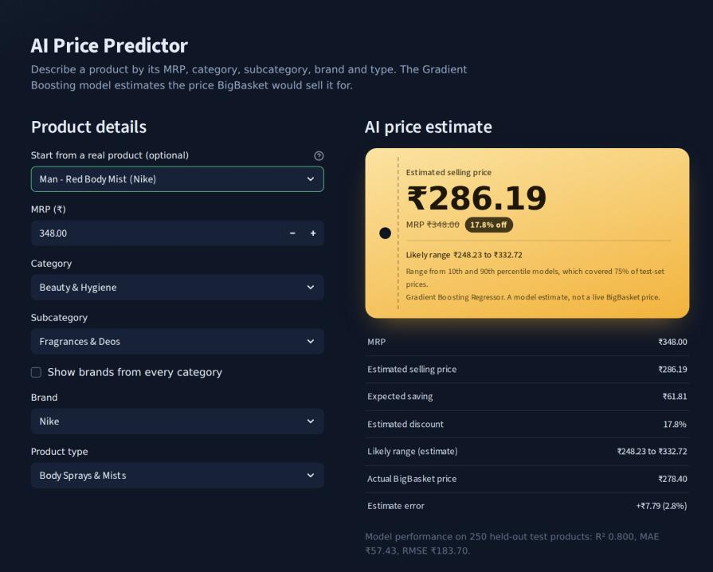

### Market Analytics

MRP versus selling price visual analysis.

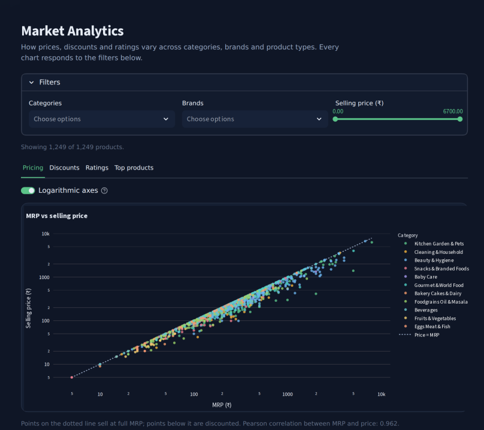

### Product Comparison

Compare products with value scoring.

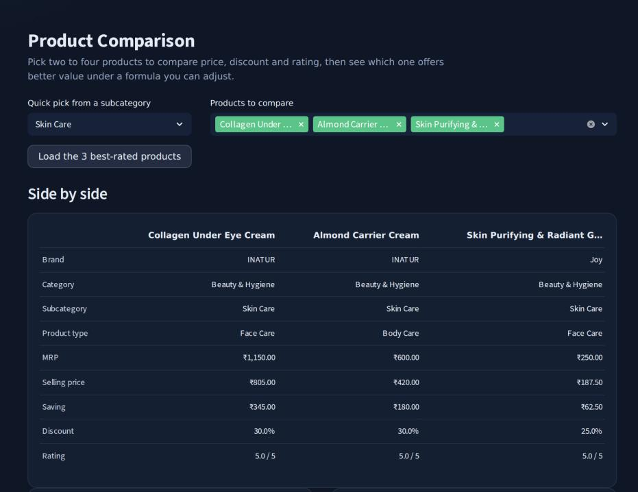

### AI Insights

Dataset-derived rule-based observations.

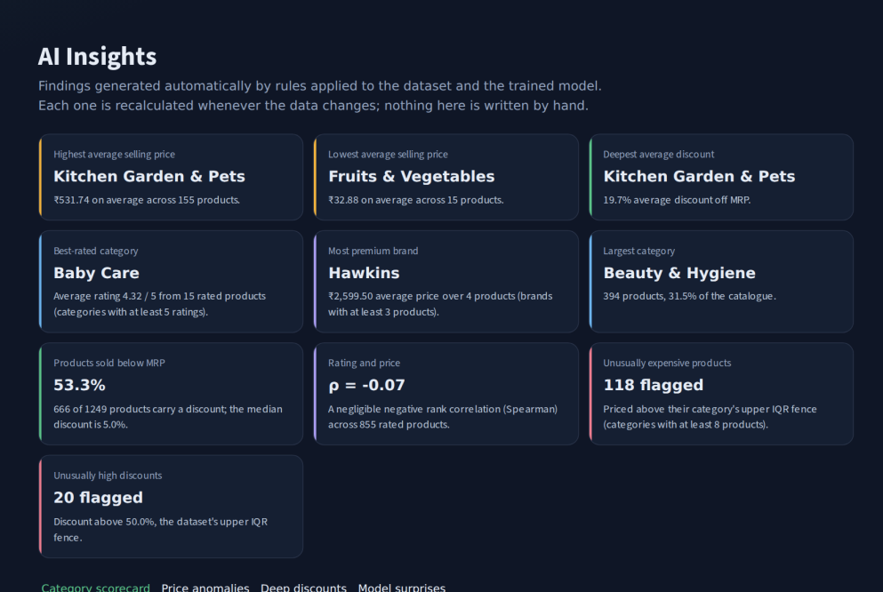

### Model Lab

Test metrics and model comparison.

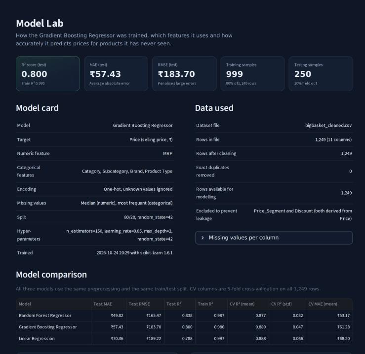

### About Project

Dataset, methodology and technologies.

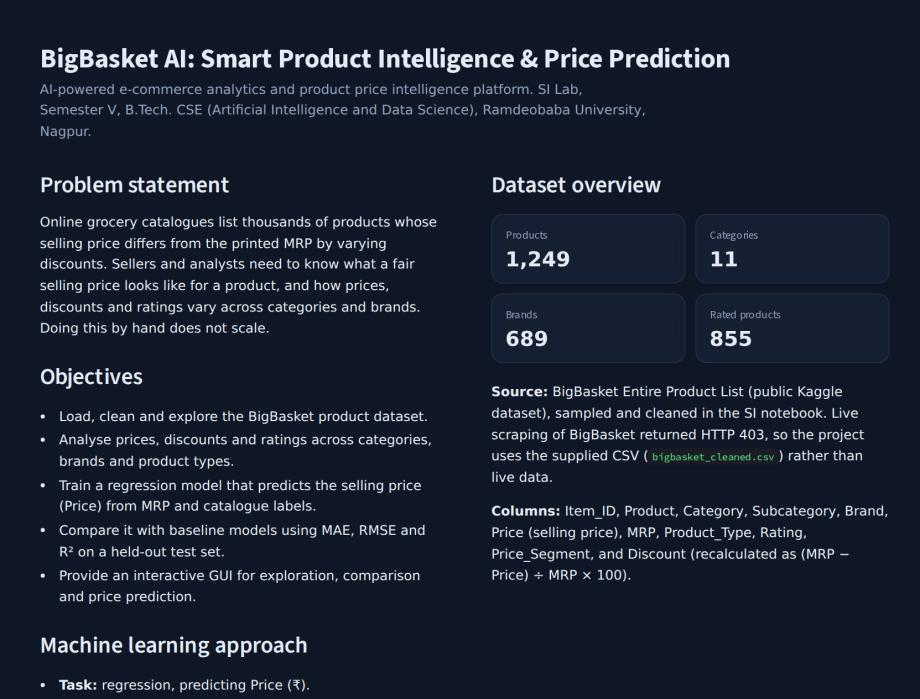

## Diagrams and evaluation plots

### Project workflow

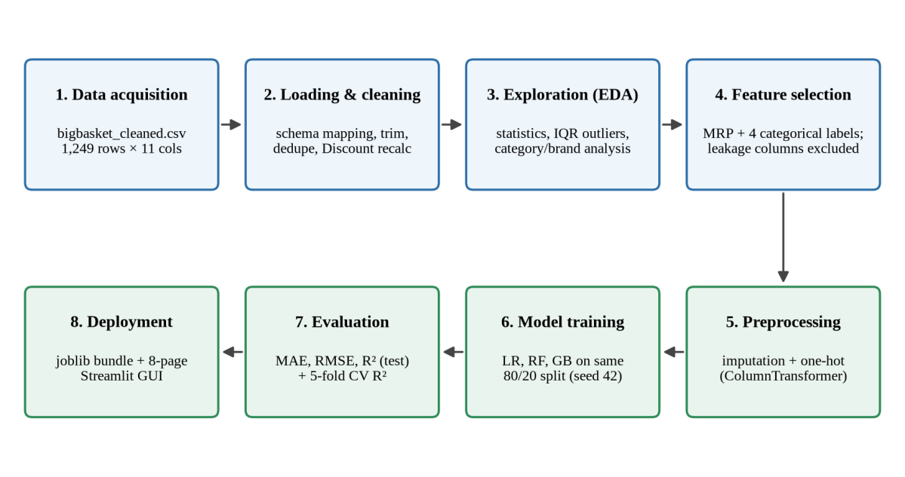

### Dataset distributions

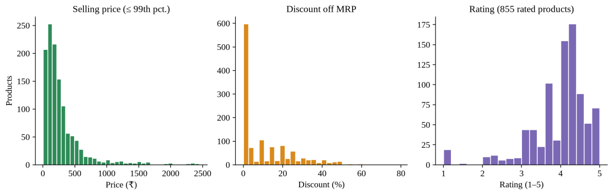

### Model comparison

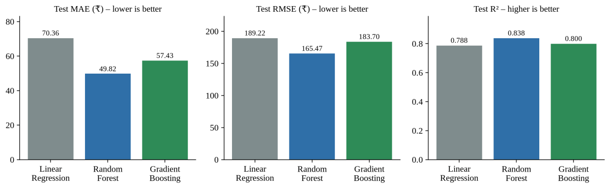

### Actual vs predicted and residuals

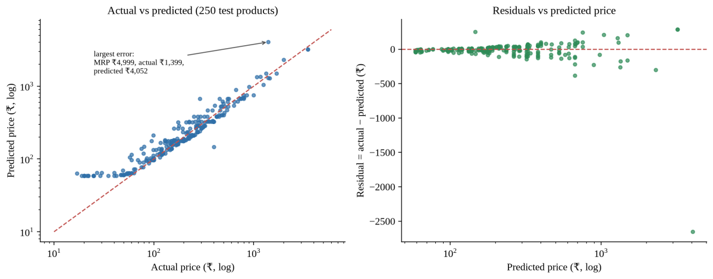

## Full project report

[BigBasket AI Project Report (PDF)](reports/BigBasket_AI_Project_Report.pdf)

## Key context from report

- Dataset: 1,249 products, 11 categories and 689 brands.
- Models compared: Linear Regression, Random Forest and Gradient Boosting.
- Deployed predictor: Gradient Boosting (test R² = 0.800, MAE = ₹57.43, RMSE = ₹183.70).
- Random Forest had the best test-set metrics (test R² = 0.838).
- Reported application: eight Streamlit pages.

> Values and screenshots are based on the submitted report. No live model or repository contents were re-tested during extraction.
